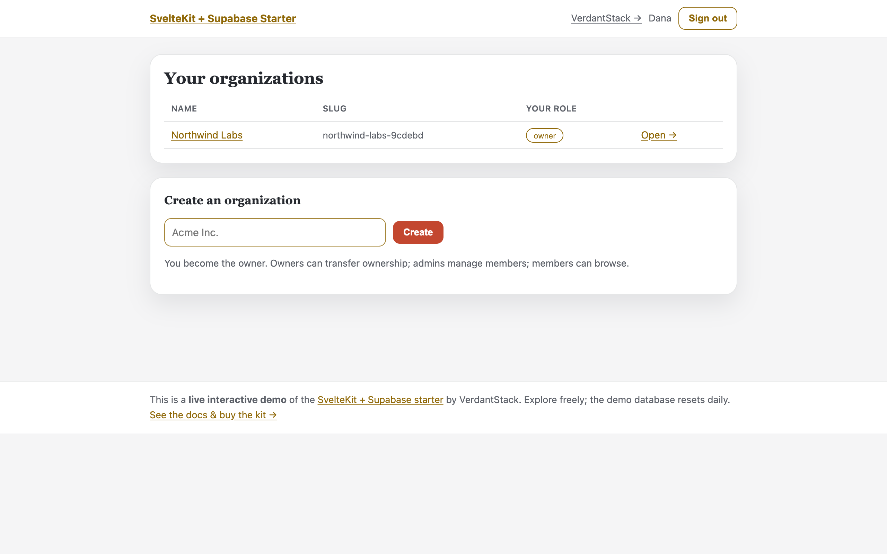
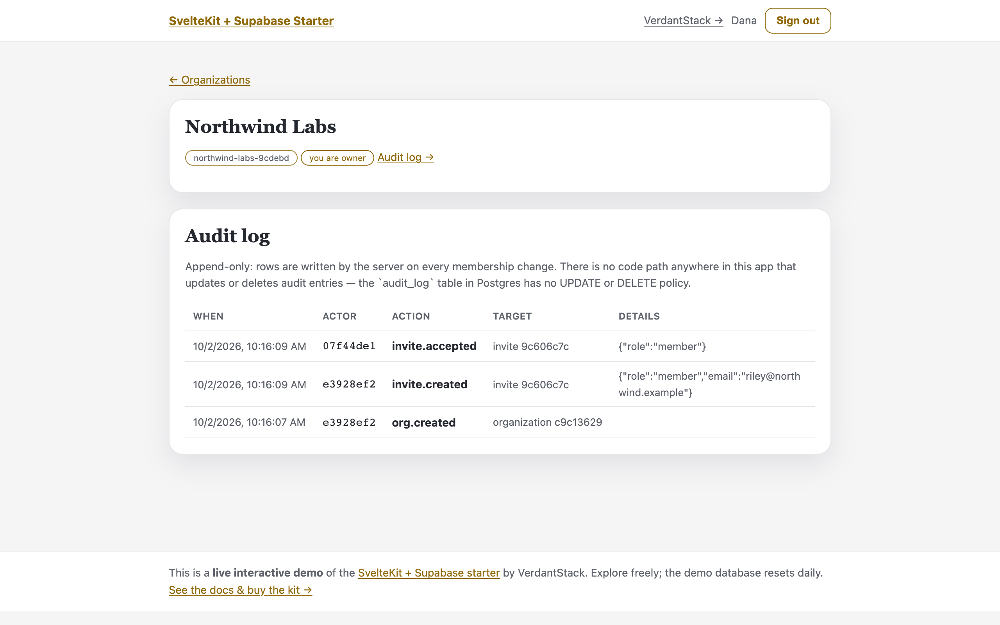
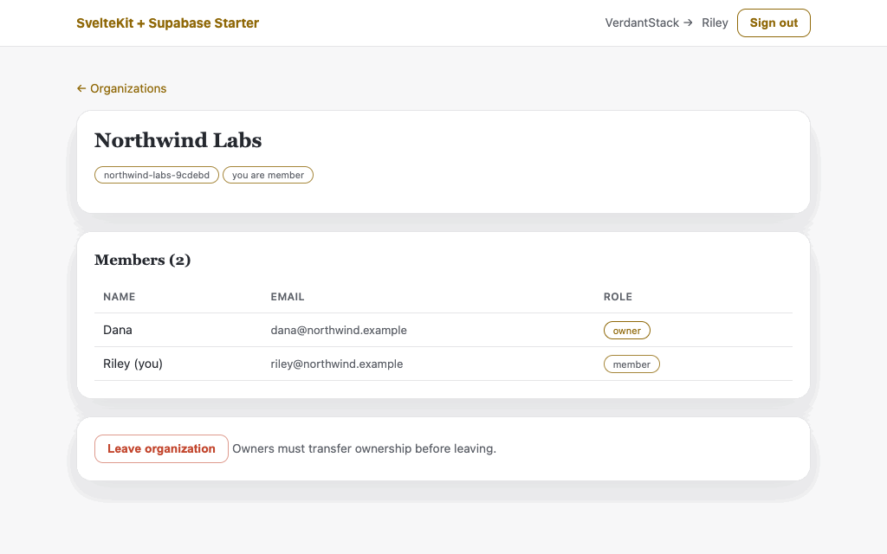
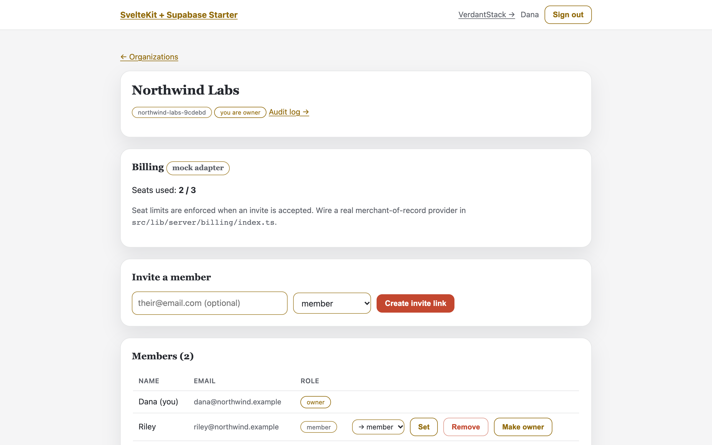
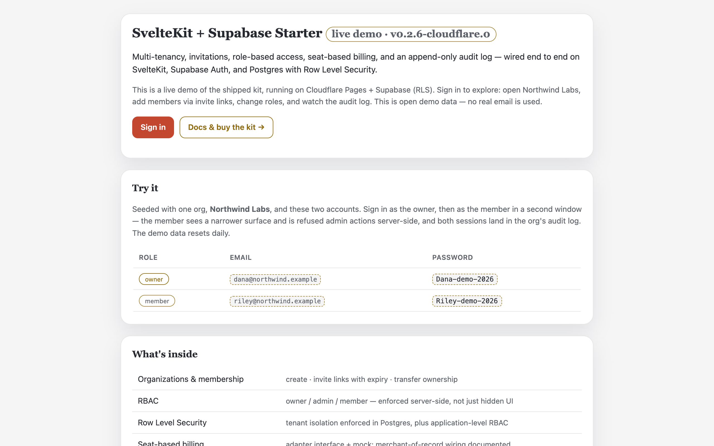
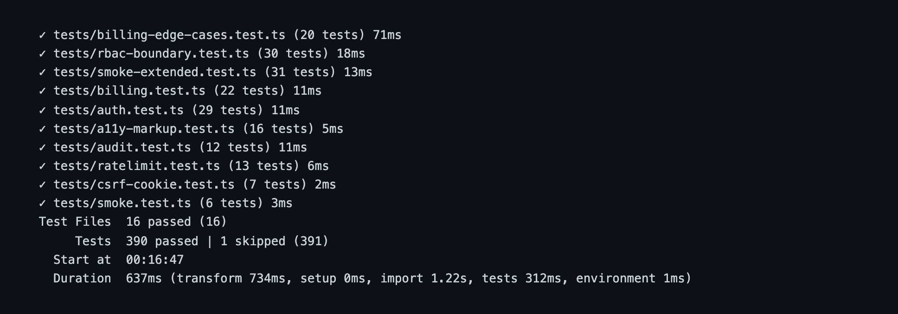

<p align="center">
  
</p>

<h3 align="center">SvelteKit + Supabase Starter</h3>

<p align="center">
  A B2B SaaS foundation for <strong>SvelteKit + Supabase</strong> with multi-tenancy wired end to end.
</p>

<p align="center">
  organizations & membership · invite links · role-based access control · seat-based billing · append-only audit log · Supabase RLS for tenant isolation · failed-login rate limiting · tested where it hurts.
</p>

<p align="center">
  <a href="https://verdantstack.dev/products/sveltekit-supabase-starter/">Documentation & guides →</a>
</p>

---

> ## 🔒 Get the full source
>
> This repository showcases the **SvelteKit + Supabase Starter**: the feature
> list, architecture docs, and screenshots below. The complete production source
> code (RBAC, invites, seat billing, audit log, Supabase RLS, rate limiting) is included with
> your purchase.
>
> **Try the live demo → [supabase-starter.verdantstack-site.pages.dev](https://supabase-starter.verdantstack-site.pages.dev/)** — click through
> organizations, invites, RBAC, and the audit log for free.
>
> **[Buy the kit →](https://www.paypal.com/ncp/payment/TRHTAC76U2ECU)** — one-time
> license · 30-day refund · **lifetime updates + 12 months standard support**.
> Questions? [verdantstack@proton.me](mailto:verdantstack@proton.me)

---

<!-- Metadata for AI agents and tooling -->
<!--
project_name: sveltekit-supabase-starter
project_type: starter-kit
language: TypeScript
framework: SvelteKit
database: PostgreSQL (via Supabase)
auth: Supabase Auth
testing: Vitest
license: Proprietary
version: 0.4.3
status: active
test_count: 636
changelog: https://github.com/verdantstack/sveltekit-supabase-starter/blob/main/CHANGELOG.md
releases: https://github.com/verdantstack/sveltekit-supabase-starter/releases
website: https://verdantstack.dev/products/sveltekit-supabase-starter/
repository: https://github.com/verdantstack/sveltekit-supabase-starter
support_email: verdantstack@proton.me
support_patreon: https://www.patreon.com/cw/VerdantStack
features:
  - multi-tenancy
  - role-based-access-control
  - seat-billing
  - audit-log
  - supabase-rls
  - invite-links
  - rate-limiting
tags: sveltekit, supabase, saas, starter, boilerplate, multi-tenant, rbac, billing, audit, rls
-->

> ### 📄 What this repository is
>
> This is the **public proof layer**: documentation, the TypeDoc API reference,
> architecture notes, screenshots and the changelog. The runnable SvelteKit
> application is **not** here — `src/` is intentionally absent.
>
> **The source ships with your purchase.** See the
> [End User License Agreement](https://verdantstack.dev/docs/license/).
>
> **New here and want to see it run first?** Try the
> [live demo](https://supabase-starter.verdantstack-site.pages.dev/) — it is the same kit, deployed and seeded, and it resets
> daily.

## Status

**Version**: 0.4.3 | Last Updated: 2026-10-27 | **License**: Proprietary

[](CHANGELOG.md)
[](https://github.com/verdantstack/sveltekit-supabase-starter/releases)
[](https://www.patreon.com/cw/VerdantStack)
[](https://github.com/verdantstack/sveltekit-supabase-starter/blob/main/AGENTS.md)

- [x] Auth: Supabase Auth (email+password, magic links, OAuth)
- [x] Multi-tenancy: organizations, membership, invites, audit log — tenant-scoped **reads** go through a user-scoped Supabase client, so the RLS policies are live at runtime; writes go through the service-role client (see [Supabase RLS](#supabase-rls))
- [x] Invites: single-use hashed tokens, 7-day expiry, revoke, atomic claim
- [x] RBAC: `owner > admin > member`, capability matrix + hierarchy rules enforced server-side
- [x] Billing: `BillingAdapter` interface + `MockBillingAdapter` (seat limits enforced at join time, in exactly one place)
- [x] Audit log: append-only by construction (no UPDATE/DELETE path exists), with CSV/JSON export at `/app/org/[id]/audit/export` — paged, capped, and spreadsheet-formula guarded
- [x] HTTP semantics: domain errors map to real statuses (403 RBAC / 404 not-found / 400 bad input), never a 200 with an error string
- [x] RLS policies: shipped in `supabase/migrations/` and **actively enforced on every tenant-scoped read**; audit export and the audit page are covered too
- [x] Rate limiting: sliding-window failed-attempt limiter on login/signup, enforced before any Supabase Auth round-trip
- [x] Tests: 636 tests — service-level (fake Supabase), real route-action status codes, schema contract, covering RBAC, orgs, invites, billing, audit, rate limiter
- [x] User profile/settings, dark mode toggle, legal pages (privacy/terms), landing pages
- [x] Org lifecycle (update/delete), account deletion (GDPR)
- [x] Waitlist, shared rate limiter, webhook management
- [x] In-app notifications, file upload/storage, API keys
- [x] Audit retention / SIEM export, user impersonation, session security hardening
- [x] Blog / content system, OpenAPI docs, i18n (4 locales)
- [x] MFA/2FA (TOTP) (OAuth/social login via Supabase Auth)
- [x] Stripe billing adapter, usage-based billing, affiliate/referral system
- [x] Admin dashboard, E2E testing (Playwright), AI SDK integration
- [ ] Real MoR billing adapter (in progress — plugs into the same `BillingAdapter` seam)

## Why this exists

[FACT] CMSaasStarter has 2,362★ on GitHub (measured 2026-09-17) proving demand for SvelteKit + Supabase starters. But it lacks multi-tenancy, RBAC, seat billing, and audit logging — the hard parts of any B2B SaaS.

This starter handles those hard parts so you can focus on your actual product.

## See it in action

Real UI captured from the **live deployed demo** — [supabase-starter.verdantstack-site.pages.dev/](https://supabase-starter.verdantstack-site.pages.dev/) (seeded org, resets daily; click through free, no login needed to explore):

| Organizations home — sign in, pick an org                                           | Audit log — every event recorded, append-only                                    |
| ----------------------------------------------------------------------------------- | -------------------------------------------------------------------------------- |
|  |  |

### Role-based access control is enforced server-side — real session, ~3s

A member's view renders no admin controls; even a hand-crafted POST to promote the owner is rejected by the app with a real HTTP 403.

> **What "real HTTP 403" means here.** Every action in the org route maps its
> caught domain error through `lib/server/http.ts::errorToFail`, so a denial is
> an HTTP status and not just an error string in a `200 OK` body. RBAC failures
> (`forbidden`, `hierarchy_violation`, `no_membership`) are **403**, a missing
> org is **404**, other known domain errors are **400**, and anything unexpected
> is a generic **500**. `redirect()` is re-thrown rather than converted, so a
> successful action can never be reported as a failure after its side effects
> committed. `tests/http-status.test.ts` drives the real `+page.server.ts`
> actions and asserts `result.status` — it is a test of the shipped route, not
> of a re-implementation of it.
>
> Historically this page returned `200 OK` with `{ error: "..." }`: the write was
> always blocked server-side, but the response said nothing about it. Fixed; see
> CHANGELOG.



<details>
<summary>More screenshots (docs/screenshots)</summary>

| Shot                                                                                           | Shows                                                                                                                                                                                                             |
| ---------------------------------------------------------------------------------------------- | ----------------------------------------------------------------------------------------------------------------------------------------------------------------------------------------------------------------- |
|  | Org dashboard — members, seats, invite controls                                                                                                                                                                   |
|              | Demo landing — sign-in line + buy-kit CTA                                                                                                                                                                         |
|                                  | Verbatim `npm test` output — note: captured at the 390-test mark, before the status-code, billing-service, audit-export and schema-contract suites were added. Re-run `npm test` for the current 636-test output. |

</details>

## Quick start

> The commands below run in **your purchased copy**, which contains `src/`.
> They cannot run in this public repository — there is no application here.

```bash
# Prerequisites: Node.js 18+, Supabase project (free tier works)
npm install
cp .env.example .env.local  # Add your Supabase credentials
npm run dev                  # http://localhost:5173
npm test                     # vitest suite
npm run check                # svelte-check
```

### Supabase setup

1. Create a free project at [supabase.com](https://supabase.com)
2. Apply **both** migrations in `supabase/migrations/` — `0001_initial_schema.sql`
   (schema + RLS) then `0002_users_profile.sql` (the `public.users` profile table
   the member list embeds). `supabase db push` applies them in order; running
   only `0001` leaves the org dashboard broken, because `listMembers()` joins a
   table that `0001` does not create.
3. Copy your project URL and keys to `.env.local`

> **Do not "clean up" the `GRANT` statements.** Every table in this kit is granted
> to `anon`, `authenticated` and `service_role` in the same migration that creates
> it, and that is now required rather than tidiness. From **2026-10-30** Supabase
> stops automatically granting Data API access to tables newly created in the
> `public` schema — for existing projects as well as new ones. Without the grant,
> PostgREST answers every request for that table with
> `42501 permission denied for table`, even though the table exists, its RLS
> policies are correct, and your keys are right. Tables created before that date
> keep the grants they already have; only newly created tables lose them, which is
> why the grants sit in the migration instead of being a one-time dashboard step.
>
> `supabase db push`, a fresh `supabase db reset`, and every preview branch all
> create these tables from these files, so all three install paths need the grants
> present in the file. See [`## Schema verification`](#schema-verification) for the
> matrix and the test that enforces it.

### Docker

```bash
docker compose up -d        # build + start on http://localhost:5173
docker compose logs -f      # follow logs
docker compose down         # stop
```

Requires Supabase credentials in `.env` or environment. See [`docs/deployment.md`](docs/deployment.md) for full deployment options (VPS, Cloudflare Pages, Vercel, Fly.io).

## Architecture

```
your +page.server.ts routes   → thin: parse form → call service → fail/redirect
        (reference UI ships in src/routes — signup/login, orgs, members, invites, audit)
        ↓
services (orgs/members/invites)  → domain logic, pure functions
        ↓
rbac.ts / ratelimit.ts / billing/ → policy + seam + payment seams
        ↓
supabase/client.ts            → Supabase client (service role for admin, user-scoped for RLS)
tenant.ts                    → which client a call gets: RLS-scoped reads vs service-role writes
```

### Critical Rules

1. **Routes (yours, once wired) NEVER touch the database directly** — all writes go through services
2. **Services are framework-free** — import nothing from `@sveltejs/kit`
3. **Every mutating service call re-derives authority** — callers pass `actorRole`, fetched fresh inside the same request
4. **Errors carry machine codes** — `AuthError`, `RbacError`, `InviteError`, `MemberError`, `OrgError`, `BillingError`
5. **RLS backs up every tenant-scoped read** — application code enforces RBAC; RLS independently filters tenant data at the database (see below)

## Billing seam

`BillingAdapter` is a **pure reporting seam**. It answers "what is this org's
subscription state?" and has no seat-decision method of its own; the entire seat
policy lives in `lib/server/billing/service.ts::assertSeatAvailable`.

That split is deliberate. An earlier version had a seat check in **both** places,
and they drifted:

- the adapter compared its constructor's `seatLimit` against a _caller-supplied_
  member count, while the service compared `state.planSeats` against the _real_
  membership count;
- only the service treated `status: 'none'` as blocking.

One decision point cannot disagree with itself, so there is now one. A real
merchant-of-record adapter is still consulted — `getSubscriptionState()` is where
it calls the provider — so an outage throws from there and propagates unchanged,
and because the check runs before the invite claim, a failed check never burns an
invite.

| Concern                                     | Owner                                             |
| ------------------------------------------- | ------------------------------------------------- |
| What is the org's subscription state?       | `BillingAdapter` (reports)                        |
| May this org add a member, and if not, why? | `billing/service.ts::assertSeatAvailable`         |
| What counts as a seat?                      | `countActiveSeats()`, counting `memberships` rows |

Invite **creation** is not limited — the limit surfaces at accept time with an
actionable error, so a full org never burns an invite it cannot honour.

## RBAC Model

**Roles:** `owner` (rank 2) > `admin` (rank 1) > `member` (rank 0)

**Hierarchy rules (enforced everywhere):**

1. Act downward only — `rank(actor) > rank(target)`
2. Grant strictly below yourself — `rank(actor) > rank(granted)`
3. No self-modification
4. Single-owner invariant — last owner cannot leave or be removed

**Capability matrix** (in `rbac.ts` `MATRIX`):

- `owner`: all permissions
- `admin`: org.view, members.view, members.invite, members.remove*, members.role.set*, invites.revoke, audit.view
- `member`: org.view, members.view

*subject to hierarchy rules

## Supabase RLS

Row Level Security policies scope every row to the tenant that owns it:

- Users can only see organizations they belong to
- Memberships are scoped to the user's organizations
- Invites are scoped to the user's organizations
- Audit logs are scoped to the user's organizations
- Profiles (`public.users`) are visible to the user and to people sharing an org
- Service role bypasses RLS for admin operations

**These policies are live, not decorative.** Which client a call uses is decided
in one place, `src/lib/server/tenant.ts`:

| Path                                                                                            | Client                                    | RLS enforced? |
| ----------------------------------------------------------------------------------------------- | ----------------------------------------- | ------------- |
| Listing orgs, loading one org, listing members, listing pending invites                         | `requireTenantClient(locals.accessToken)` | **Yes**       |
| Audit log page, audit count, CSV/JSON export                                                    | `requireTenantClient(locals.accessToken)` | **Yes**       |
| The membership re-derivation that guards every mutating action                                  | `requireTenantClient(locals.accessToken)` | **Yes**       |
| Creating an org, creating/revoking invites, role changes, removals, leaving, ownership transfer | `createServerClient()` (service role)     | No            |
| Writing the `audit.exported` entry                                                              | `createServerClient()` (service role)     | No            |

### Why writes still use the service role

This is deliberate, and it is the correct design rather than a shortcut:

1. **The audit log.** `audit_insert` in migration `0001` is
   `FOR INSERT WITH CHECK (true)`. A user-scoped audit write would therefore let
   _any_ authenticated user append rows to _any_ org's history — forging a
   compliance record. The service-role client is the control that prevents it.
2. **A real conflict between the policies and the capability matrix.** `MATRIX`
   grants `members.role.set` and `members.remove` to `admin` (`rbac.ts`), but
   `memberships_update` and `memberships_delete` in migration `0001` both
   require `owner`. Routing those two writes through a user-scoped client would
   silently break a documented admin capability at the database layer. Resolving
   it means changing the matrix or changing the policies — a product decision,
   so it is documented here instead of quietly routed around.
   **If you move those writes yourself, read that policy first.**
3. **Unauthenticated flows.** `peekInvite` runs for signed-out visitors holding
   only a token, and `invites_select` requires org membership, so an anon client
   could not read the row at all.

> Earlier versions of this kit used the service-role client for **everything** —
> `createUserClient` had no call sites, so the policies shipped but never ran.
> The read paths above are now RLS-scoped. `tests/tenant-client.test.ts` pins the
> split so it cannot quietly flatten back.

See `supabase/migrations/` for the full policy definitions.

## Schema verification

`supabase/migrations/0002_users_profile.sql` adds the `public.users` profile
table that `listMembers()` embeds, keeps it in sync from `auth.users` via a
trigger, and adds the foreign key PostgREST needs to plan the join. Apply **both**
migrations, in order:

```bash
supabase db push            # applies 0001 and 0002
```

`0002` is additive and idempotent — no drops, no column rewrites, and every
statement is guarded, so applying it to a project that already has a
`public.users` table is a no-op rather than an error or an overwrite.

`tests/schema-contract.test.ts` cross-checks every relation the server queries
against the migrations, **including the foreign key** — a table that exists but
has no relationship would still break the embed, with a different error, so
checking only for the table would pass while the feature stayed broken.

### Data API grants

Each migration grants its own tables to the three PostgREST roles, in the file
that creates them. This is the matrix, and it mirrors Supabase's documented
default for new tables so that behaviour after 2026-10-30 matches behaviour
before it:

| Role            | `organizations` | `memberships` | `invites` | `audit_log` |  `users`  |
| --------------- | :-------------: | :-----------: | :-------: | :---------: | :-------: |
| `anon`          |     SELECT      |    SELECT     |  SELECT   |   SELECT    |  SELECT   |
| `authenticated` |    all four¹    |   all four¹   | all four¹ |  all four¹  | all four¹ |
| `service_role`  |    all four¹    |   all four¹   | all four¹ |  all four¹  | all four¹ |

¹ `SELECT, INSERT, UPDATE, DELETE`

Three things about that table are worth knowing before you change it:

- **`service_role` needs it.** Bypassing RLS is not bypassing the privilege
  system. The kit's own admin writes — org creation, invites, role changes,
  removals, ownership transfer, and the audit entry they write — run through the
  service-role client, and they fail with 42501 if the grant is missing.
- **The grants are not what keeps `audit_log` append-only.** That is the absence
  of an UPDATE or DELETE _policy_, which no non-bypassing role can satisfy no
  matter what it is granted. `authenticated` is granted the full four to match
  the vendor matrix; the append-only guarantee is untouched.
- **`anon` is read-only.** The test fails if a write privilege is ever granted to
  it, so this cannot drift one `GRANT` at a time.

`tests/schema-contract.test.ts` enforces all of it statically — it parses every
migration, and fails naming the file, table, role and missing privilege if a
created table is not granted in that same file. It also checks the demo schema
when that directory is present. Deleting any single `GRANT` line makes `npm test`
fail, so the check is not one that can only pass.

**What this does not cover.** It is a parser, not Postgres: it proves the
statement is in the file, not that the database accepted it. To verify the real
privileges on a live project:

```sql
SELECT table_name, grantee, string_agg(privilege_type, ', ' ORDER BY privilege_type)
FROM information_schema.role_table_grants
WHERE table_schema = 'public'
  AND grantee IN ('anon', 'authenticated', 'service_role')
GROUP BY table_name, grantee
ORDER BY table_name, grantee;
```

Each of the five tables should appear three times, once per role.

## Audit log

Append-only by construction: `audit_log` has no UPDATE or DELETE policy, and no
code path in this kit writes one. Read it at `/app/org/[id]/audit`, or export it
as CSV/JSON at `/app/org/[id]/audit/export` (both admin/owner-gated, re-checked
server-side).

## Audit export safety

The export at `/app/org/[id]/audit/export` is reachable through query parameters,
so it is defensive about all three:

- **Paging** — `limit` and `offset` go through `clampExportPage()`: `limit` is
  floored at 1 and capped at `MAX_EXPORT_ROWS` (10 000), `offset` is floored at 0
  (a negative offset is an error, not "from the start"). Without a ceiling one
  request could ask for the entire append-only log.
- **Spreadsheet formulas** — Excel/LibreOffice/Sheets evaluate a leading `=`,
  `+`, `-` or `@` as a formula, so such a value is prefixed with an apostrophe.
  The guard runs on the **raw** value _before_ CSV quoting: quoting first leaves
  the field starting with a double quote, which matches no trigger, so the
  canonical `=HYPERLINK("…")` payload — which necessarily contains a quote —
  would sail through. `tests/audit-export.test.ts` pins that exact case, and
  fails if the two steps are swapped.
  In this schema it is defence-in-depth rather than a live hole: `action`,
  `targetType` and `targetId` are app-written constants and `actorUserId` is a
  UUID, so no cell can begin with `=` today. It is there for the buyer who adds a
  free-form field later.
- **Escaping** — commas, quotes, newlines and carriage returns are RFC 4180
  escaped so every value round-trips through a conforming parser, checked by a
  parser written independently of the writer.

## Environment Variables

| Variable                            | Purpose                                                   |
| ----------------------------------- | --------------------------------------------------------- |
| `PUBLIC_SUPABASE_URL`               | Your Supabase project URL                                 |
| `PUBLIC_SUPABASE_ANON_KEY`          | Your Supabase anonymous key                               |
| `PRIVATE_SUPABASE_URL`              | Your Supabase project URL (server only)                   |
| `PRIVATE_SUPABASE_ANON_KEY`         | Your Supabase anon key (server only; user-scoped clients) |
| `PRIVATE_SUPABASE_SERVICE_ROLE_KEY` | Your Supabase service role key (server only)              |
| `MOCK_PLAN_SEATS`                   | Seat limit for MockBilling (default: 3)                   |
| `AUTH_FAILED_ATTEMPTS`              | Failed attempts allowed per window (default: 5)           |
| `AUTH_WINDOW_MS`                    | Sliding window for failed auth attempts (default: 900000) |

## Testing

- **Framework:** Vitest
- **Runtime:** service-level tests run against an in-memory fake Supabase client — no database needed
- **RLS-level checks:** `supabase start` (see `docs/testing.md`)
- **Run:** `npm test` (636 tests)

### Test Files

| File                                | Coverage                                                                                          |
| ----------------------------------- | ------------------------------------------------------------------------------------------------- |
| `tests/rbac.test.ts`                | Matrix pinning, hierarchy rules                                                                   |
| `tests/orgs-members.test.ts`        | Org CRUD, membership management, role hierarchy, transfer invariants                              |
| `tests/invites-seats.test.ts`       | Invite lifecycle, atomic single-use claim, expiry/revoke, seat limits                             |
| `tests/billing.test.ts`             | Mock adapter contract, seat boundaries, env override                                              |
| `tests/auth.test.ts`                | Auth helpers, password validation, session management                                             |
| `tests/ratelimit.test.ts`           | Sliding-window semantics, eviction, env-driven configuration                                      |
| `tests/billing-edge-cases.test.ts`  | Seat upgrades/downgrades, adapter failures, boundary conditions                                   |
| `tests/rbac-boundary.test.ts`       | Cross-org isolation, rank escalation, hierarchy enforcement                                       |
| `tests/service-integration.test.ts` | Full multi-step flows through the service layer                                                   |
| `tests/audit.test.ts`               | Append-only audit writer, metadata serialization                                                  |
| `tests/smoke.test.ts`               | Build verification, constants, adapter instantiation                                              |
| `tests/edge-cases.test.ts`          | Cross-cutting edge cases — unicode slugs, error hierarchy, audit edges, multi-module flows        |
| `tests/smoke-extended.test.ts`      | Extended smoke — constant pinning, type verification, module-export sanity                        |
| `tests/http.test.ts`                | Domain error → HTTP status mapping, redirect propagation                                          |
| `tests/http-status.test.ts`         | **Real route actions**: the status a browser POST actually receives (403/404/400)                 |
| `tests/billing-service.test.ts`     | Single seat-enforcement point: seat boundary, subscription states, provider errors                |
| `tests/audit-export.test.ts`        | `countAudit` + CSV/JSON export, CSV escaping round-trip, append-only                              |
| `tests/audit-export-route.test.ts`  | Audit export endpoint: 401/403/404 gating, headers, export audit entry                            |
| `tests/schema-contract.test.ts`     | Every queried relation exists **and is related**; every created table carries its Data API grants |
| `tests/tenant-client.test.ts`       | The read/write client split, so RLS cannot quietly stop being enforced                            |
| `tests/defects.test.ts`             | Regression tests for defects found by review (slug retry, error codes)                            |

## Choose your data layer

This starter pairs SvelteKit with **Supabase** (PostgreSQL). The same kit is also available with a self-hosted **SQLite** data layer. The table below compares the two data-layer options.

| Feature       | SQLite edition                         | Supabase edition (this repo)              |
| ------------- | -------------------------------------- | ----------------------------------------- |
| Database      | SQLite (better-sqlite3 + Drizzle)      | PostgreSQL (via Supabase)                 |
| Auth          | Custom scrypt + sessions               | Supabase Auth                             |
| Multi-tenancy | Application-level                      | RLS on reads + application-level          |
| Realtime      | Not included                           | Supabase Realtime                         |
| Hosting       | Any (Cloudflare Workers, Vercel, etc.) | Supabase-hosted database                  |
| Best for      | Self-contained, zero-dependency        | Managed infrastructure, realtime features |

## Versioning & Releases

**Standing Rule:** Releases are cut by the VerdantStack release pipeline (bump → changelog → tag → public release) — this repo has no `npm run release`. Merges must keep the tree green:

```bash
npm test               # 636 tests
npm run check          # svelte-check
npm run build          # production build
npm run docs:api:check # API reference in sync (typedoc)
```

See [CHANGELOG.md](CHANGELOG.md) for change history and [docs/versioning.md](docs/versioning.md) for the full process.

## License

The full source is included with your purchase under the
[End User License Agreement](https://verdantstack.dev/docs/license/).

**[Buy the kit →](https://www.paypal.com/ncp/payment/TRHTAC76U2ECU)**

30-day refund policy. Contact: verdantstack@proton.me

---

<p align="center">
  Built by <a href="https://github.com/verdantstack">VerdantStack</a>
</p>

<p align="center">
  <sub>Like this project? <a href="https://www.patreon.com/cw/VerdantStack">Support us on Patreon</a> for $5/month.</sub>
</p>
