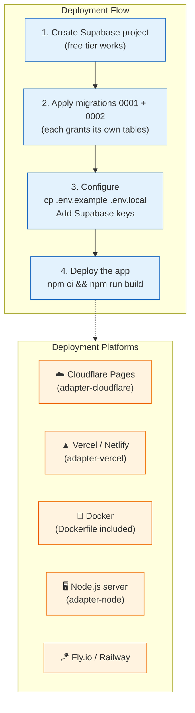
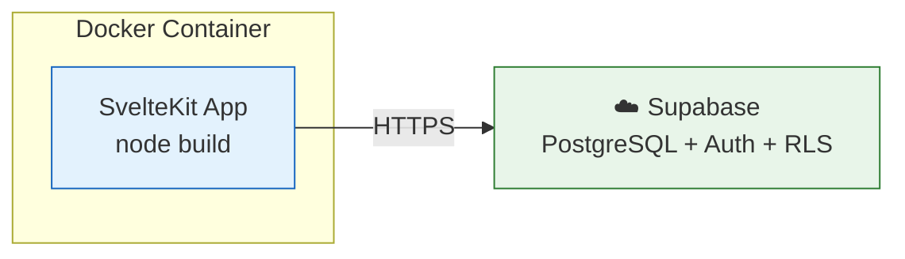

# Deployment

This kit is a SvelteKit application that connects to **Supabase** (managed PostgreSQL + Auth + RLS). Deploy the app anywhere SvelteKit runs, point it at your Supabase project, done.



## 1. Quick start (local)

```bash
npm install
cp .env.example .env.local    # Add your Supabase credentials
npm run dev                   # http://localhost:5173
```

## 2. Supabase setup

1. Create a free project at [supabase.com](https://supabase.com)
2. Apply **both** migrations, in order — `0001_initial_schema.sql` then
   `0002_users_profile.sql` — via the SQL Editor or the Supabase CLI:

   ```bash
   supabase db push            # applies 0001 and 0002, in order
   ```

   Applying only `0001` leaves the org dashboard broken: `listMembers()` embeds
   `users!inner(...)`, and `0001` creates no `users` relation.

3. Copy your project URL and keys to `.env.local`

### Data API grants (do not remove)

Each migration grants its own tables to `anon`, `authenticated` and
`service_role`. Keep those statements.

From **2026-10-30** Supabase stops automatically granting Data API access to
tables newly created in the `public` schema — for **existing** projects as well
as new ones. Without the grant, PostgREST answers every request for the table
with `42501 permission denied for table`, even though the table exists, its RLS
policies are correct and the keys are valid. Tables created before that date keep
the grants they already hold; the new default applies only to tables created on
or after the effective date.

This matters on every install path, because all of them create these tables from
these files: `supabase db push`, a fresh `supabase db reset`, preview branches,
and the dashboard SQL Editor. That is why the grants sit in the migration that
creates the table rather than in a separate step someone can forget.

`service_role` needs real privileges here — bypassing RLS is not bypassing the
privilege system, and the kit's admin writes (orgs, invites, role changes,
removals, ownership transfer, audit entries) all run as `service_role`.

To verify the privileges on a live project:

```sql
SELECT table_name, grantee, string_agg(privilege_type, ', ' ORDER BY privilege_type)
FROM information_schema.role_table_grants
WHERE table_schema = 'public'
  AND grantee IN ('anon', 'authenticated', 'service_role')
GROUP BY table_name, grantee
ORDER BY table_name, grantee;
```

`tests/schema-contract.test.ts` enforces the grants statically in the shipped
migrations, so a missing one fails `npm test` rather than the buyer's first page
load.

### Environment variables

| Variable                            | Purpose                                                   |
| ----------------------------------- | --------------------------------------------------------- |
| `PUBLIC_SUPABASE_URL`               | Your Supabase project URL                                 |
| `PUBLIC_SUPABASE_ANON_KEY`          | Your Supabase anonymous key                               |
| `PRIVATE_SUPABASE_URL`              | Your Supabase project URL (server only)                   |
| `PRIVATE_SUPABASE_ANON_KEY`         | Your Supabase anon key (server only; user-scoped clients) |
| `PRIVATE_SUPABASE_SERVICE_ROLE_KEY` | Your Supabase service role key (server only)              |
| `MOCK_PLAN_SEATS`                   | Seat limit for MockBilling (default: 3)                   |

## 3. Deploy with Docker

A `Dockerfile` and `docker-compose.yml` are included for container deployments.

```bash
# Create .env with your Supabase credentials
cp .env.example .env
# Edit .env with your Supabase keys

# Build and run
docker compose up -d        # start on http://localhost:5173
docker compose logs -f      # follow logs
docker compose down         # stop
```

### How it works



The app connects to your Supabase project over HTTPS. No local database needed — Supabase handles storage, auth, and RLS.

## 4. Deploy to Cloudflare Pages

```bash
# 1. Pin the adapter
npm install -D @sveltejs/adapter-cloudflare

# 2. Update vite.config.ts
import adapter from '@sveltejs/adapter-cloudflare';
adapter()

# 3. Deploy
npx wrangler pages deploy build
```

Set Supabase credentials in the Cloudflare Pages dashboard (Settings → Environment variables).

## 5. Deploy to Vercel / Netlify

```bash
# 1. Pin the adapter
npm install -D @sveltejs/adapter-vercel   # or adapter-netlify

# 2. Update vite.config.ts
import adapter from '@sveltejs/adapter-vercel';
adapter()

# 3. Deploy via Git integration or CLI
npx vercel --prod
```

Set Supabase credentials in the Vercel dashboard (Settings → Environment Variables).

## 6. Deploy to a VPS (Node.js server)

```bash
# On your server
git clone <repo-url> && cd sveltekit-supabase-starter
npm ci
npm run build

# Set environment variables
export PUBLIC_SUPABASE_URL=https://your-project.supabase.co
export PUBLIC_SUPABASE_ANON_KEY=your-anon-key
export PRIVATE_SUPABASE_URL=https://your-project.supabase.co
export PRIVATE_SUPABASE_ANON_KEY=your-anon-key
export PRIVATE_SUPABASE_SERVICE_ROLE_KEY=your-service-role-key

# Run with a process manager
npx pm2 start build --name supabase-starter
# or
npm run start   # if using adapter-node
```

## 7. Deploy to Fly.io / Railway

```bash
# Fly.io
fly launch
fly deploy

# Railway
# Connect your Git repo — Railway auto-detects Node.js
```

Set Supabase credentials in the platform's environment config.

## 8. Production checklist

- [ ] Supabase project is on a paid plan (or aware of free tier limits)
- [ ] RLS policies are enabled (defense-in-depth; see `supabase/migrations/`)
- [ ] Data API grants are present on every table — see "Data API grants" in §2.
      Required from 2026-10-30: a new table without them returns 42501
- [ ] Replace `MockBillingAdapter` with a real billing provider (see `docs/billing.md`)
- [ ] Enable HTTPS (reverse proxy with Caddy/Nginx, or use a platform that provides it)
- [ ] Set up Supabase database backups (included in Supabase Pro plan)
- [ ] Monitor Supabase usage (dashboard → Database → Statistics)

## Feature environment variables

| Variable                | Purpose                                                          |
| ----------------------- | ---------------------------------------------------------------- |
| `STRIPE_SECRET_KEY`     | Stripe billing adapter secret key                                |
| `STRIPE_WEBHOOK_SECRET` | Stripe webhook signing secret                                    |
| `STRIPE_PRICE_ID`       | Stripe price id for seat upgrades                                |
| `SMTP_URL`              | Transactional email (password reset, email verification)          |
| `UPLOAD_DIR`            | File upload/storage location (or Supabase Storage bucket)        |
| `OPENAI_API_KEY`        | AI SDK integration (optional)                                    |
| `MFA_ISSUER`            | TOTP issuer name (MFA/2FA)                                       |
| `OAUTH_*`               | OAuth/social login provider credentials (via Supabase Auth)       |
